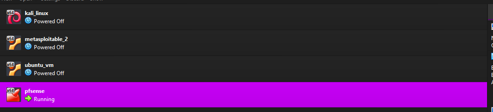
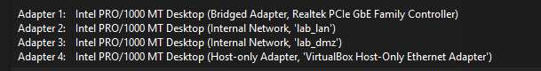
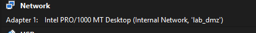
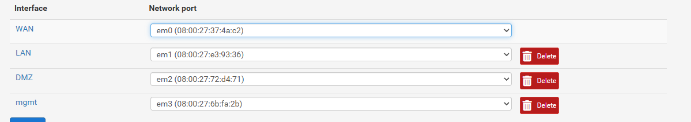
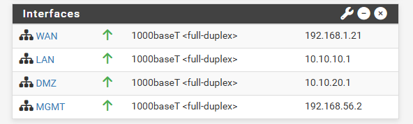
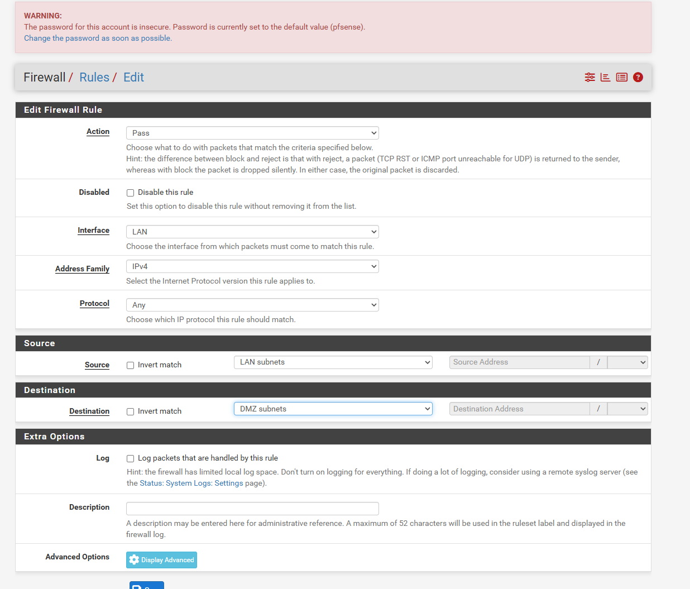
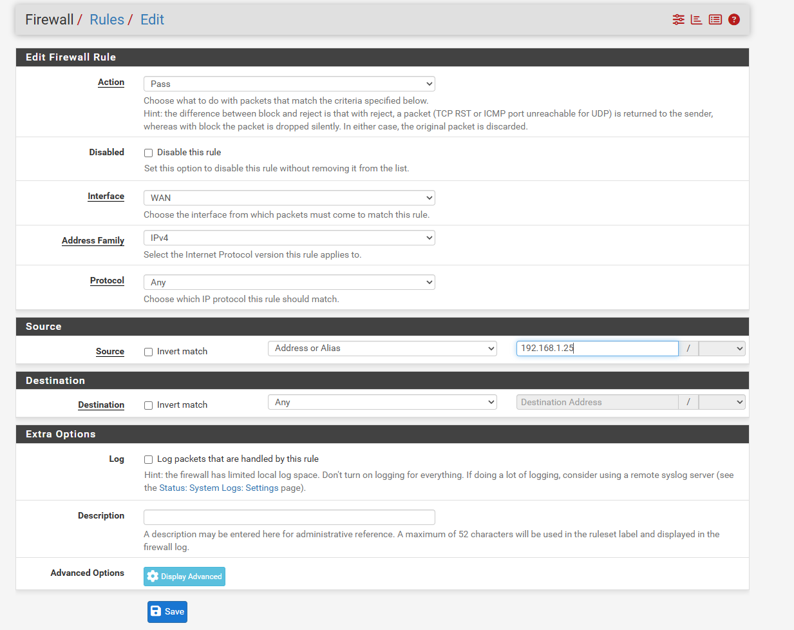
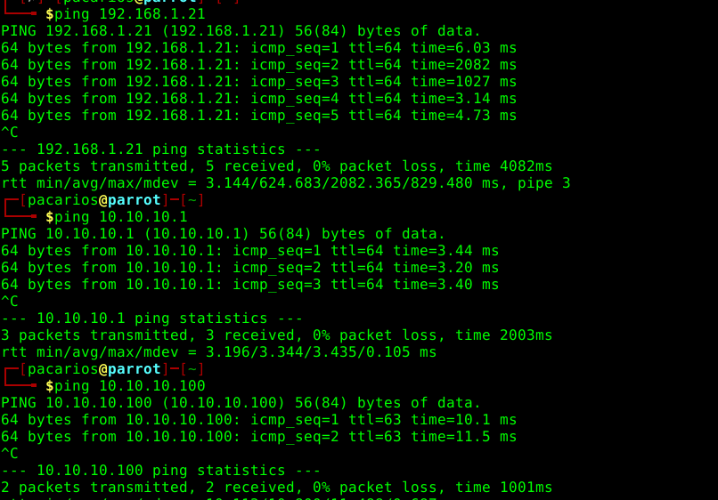
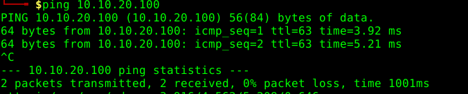

# Home Lab: New Architecture

The old lab worked, but it was missing a lot. No separate management network, no way to test from outside, and everything was kind of flat. This is the rebuild: pfSense with 4 interfaces, two internal networks, and a real physical machine attacking from the outside.

(There's also a `metasploitable_2` VM in the VirtualBox list. Ignore it, it's not part of this writeup.)

## The plan

```
        Parrot OS (physical laptop, home network)
                      |
                    [WAN]  192.168.1.21 (DHCP from home router)
                      |
  Host PC -- [MGMT] pfSense [LAN] -- Kali   10.10.10.100
  192.168.56.1  192.168.56.2   |
                             [DMZ] -- Ubuntu 10.10.20.100
```

| Interface | VirtualBox adapter | pfSense IP | What's on it |
|-----------|--------------------|------------|--------------|
| WAN | Bridged | 192.168.1.21 (DHCP) | Home router + Parrot |
| LAN | Internal (`lab_lan`) | 10.10.10.1/24 | Kali |
| DMZ | Internal (`lab_dmz`) | 10.10.20.1/24 | Ubuntu Server |
| MGMT | Host-only | 192.168.56.2/24 | My host PC (for the web UI) |

Only WAN uses DHCP. Everything else is static.

## VirtualBox setup

Here are the VMs:

 (Ignore the Metasploitable2)

pfSense gets 4 adapters, in this order: bridged, `lab_lan`, `lab_dmz`, host-only.



Kali sits on the LAN internal network, Ubuntu on the DMZ one:




## pfSense interfaces

I mapped the 4 network ports to their roles. Adapter order matters here: `em0` is WAN, `em1` LAN, `em2` DMZ, `em3` MGMT.



And the dashboard showing everything up with its IP:



## Static IPs on the VMs

LAN and DMZ have no DHCP server, so the VMs need manual addresses.

**Kali** (NetworkManager):

```bash
sudo nmcli con mod "Wired connection 1" ipv4.method manual \
  ipv4.addresses 10.10.10.100/24 ipv4.gateway 10.10.10.1 ipv4.dns 10.10.10.1
sudo nmcli con up "Wired connection 1"
```

**Ubuntu** (netplan, `/etc/netplan/<file>.yaml`):

```yaml
network:
  version: 2
  ethernets:
    enp0s3:
      dhcp4: false
      addresses:
        - 10.10.20.100/24
      routes:
        - to: default
          via: 10.10.20.1
      nameservers:
        addresses: [10.10.20.1]
```

Then `sudo netplan apply`. Result:

```
2: enp0s3: <BROADCAST,MULTICAST,UP,LOWER_UP> mtu 1500 state UP
    inet 10.10.20.100/24 brd 10.10.20.255 scope global enp0s3
```

## Firewall rules

New pfSense interfaces block everything by default, so each one needed rules.

> **Heads up:** all the firewall rules in this writeup are temporary. They're intentionally loose to get the base network working, and they will get tighter and stricter with each writeup.

**MGMT:** lets my host reach the web UI.


**LAN and DMZ:** for now I'm allowing everything on both, just to get the base network working. These are temporary and I'll replace them with specific rules later (DMZ should not be able to reach LAN).



**WAN:** only my Parrot laptop's IP is allowed in. I also had to untick "Block private networks" on the WAN interface, because my home network is a private range and pfSense drops it by default.



## Testing from Parrot

Parrot sits on my home network, so it has no idea the `10.10.x.x` networks exist. I told it to send that traffic through pfSense's WAN address:

```bash
sudo ip route add 10.10.10.0/24 via 192.168.1.21
sudo ip route add 10.10.20.0/24 via 192.168.1.21
```

Then I pinged my way inward, layer by layer:

```
$ ping 192.168.1.21        # pfSense WAN
64 bytes from 192.168.1.21: icmp_seq=1 ttl=64 time=6.03 ms

$ ping 10.10.10.1          # LAN gateway
64 bytes from 10.10.10.1: icmp_seq=1 ttl=64 time=3.44 ms

$ ping 10.10.10.100        # Kali
64 bytes from 10.10.10.100: icmp_seq=1 ttl=63 time=10.1 ms

$ ping 10.10.20.100        # Ubuntu
64 bytes from 10.10.20.100: icmp_seq=1 ttl=63 time=3.92 ms
```

Fun detail: TTL drops from 64 to 63 when it reaches Kali and Ubuntu. That's the packet passing through pfSense as one routing hop, so it proves the traffic really goes through the firewall.

**Parrot to Kali:**



**Parrot to Ubuntu:**



## Stuff that went wrong (and what I learned)

- **MGMT wouldn't connect.** The host adapter had no IP, and there's no DHCP on MGMT. Fix: static `192.168.56.1` on the host.
- **Locked out of the web UI.** I forgot the admin password and the failed logins triggered pfSense's lockout. Fix: reset the password from the console (option 3) and clear the block.
- **Ping to the gateway failed.** New interfaces are deny-by-default, so you need an explicit pass rule. ICMP is its own protocol, so a TCP-only rule doesn't cover ping.
- **Kali had no IP.** NetworkManager defaults to DHCP, and there's no DHCP server on LAN.
- **Netplan typo.** I wrote `fasle` instead of `false`. YAML is picky.
- **Ubuntu ignored Kali's pings.** The host firewall (nftables) was still set up for the old subnets and dropped them. Fix: sort out the ruleset for the new networks.
- **Parrot couldn't get in.** Needed the WAN pass rule, "Block private networks" turned off, and static routes on Parrot.

## What's next

- Replace the temporary allow-all rules with specific ones, and block DMZ to LAN
- Get Suricata running on the new interfaces
- Build the SIEM (ELK) to pull in logs from everything
